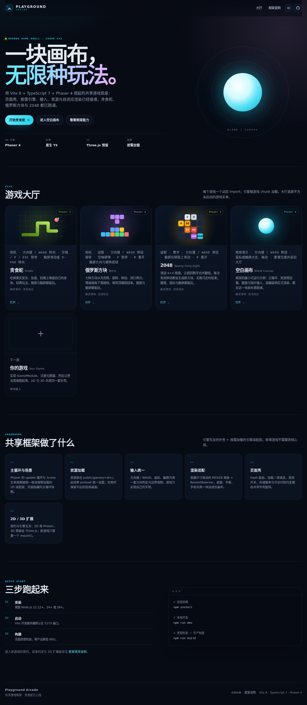
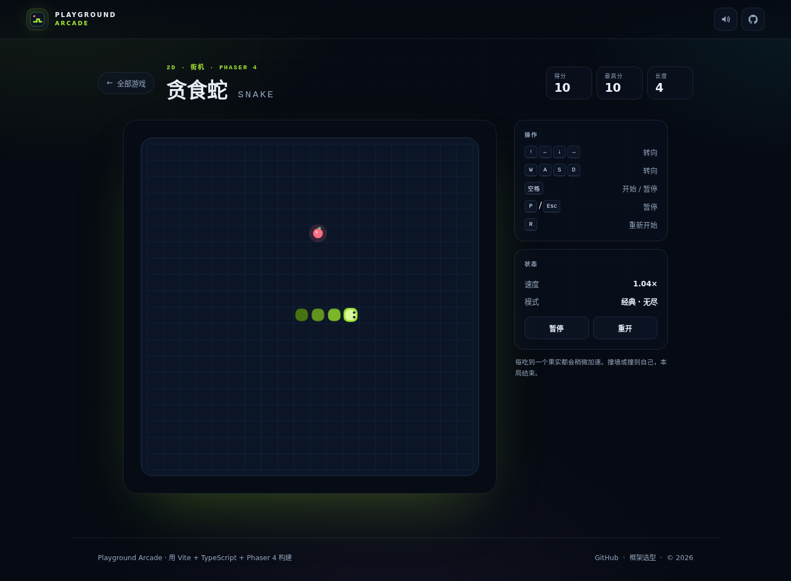
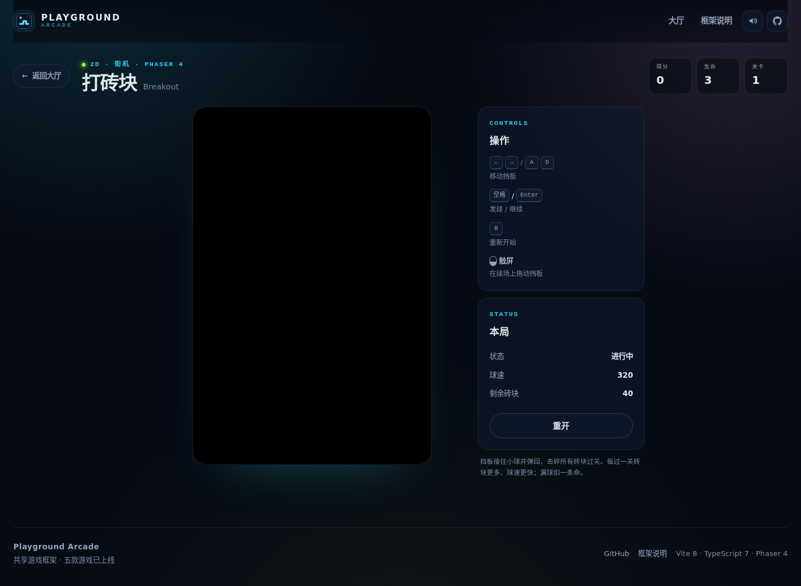
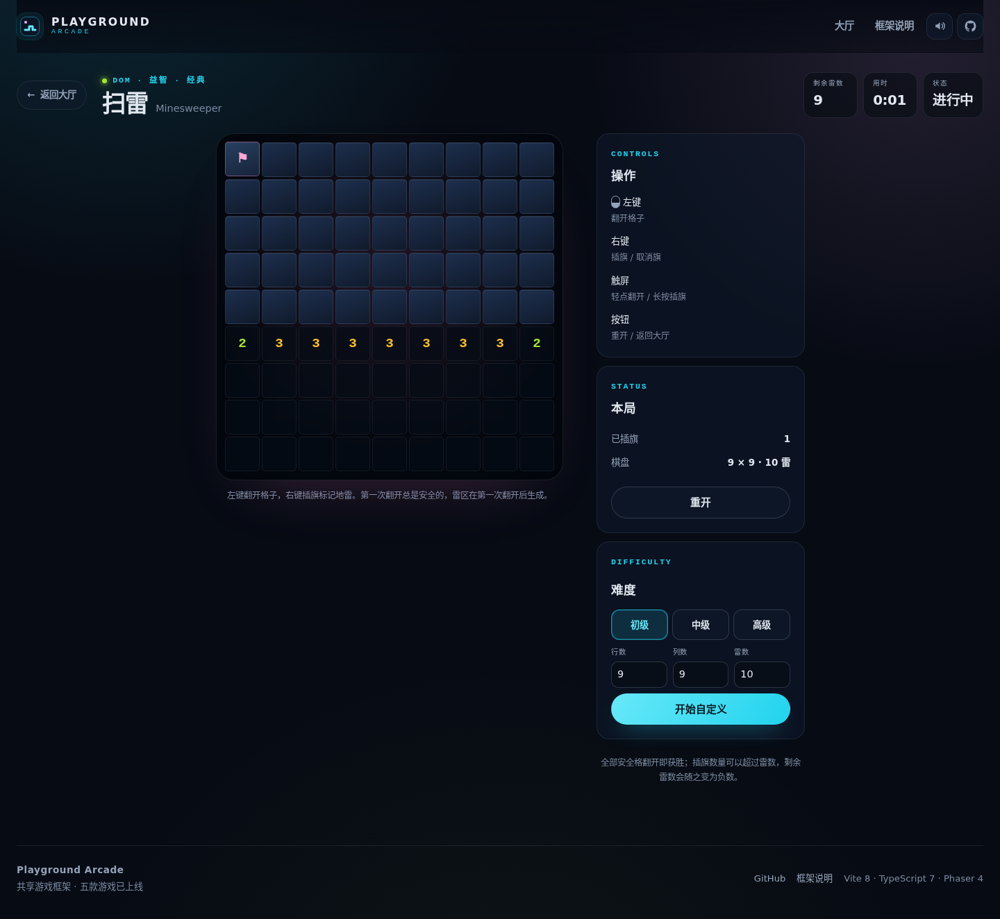
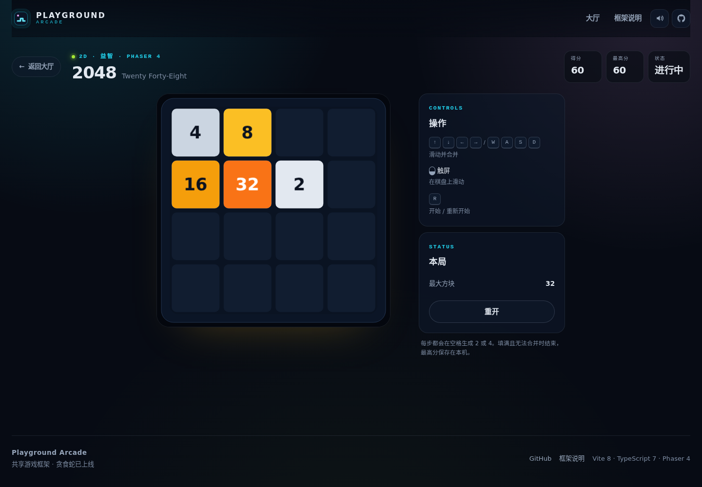

# playground

本仓库用于验证 dsh-superagent 的端到端流程，随时可能被自动改写。

供 dsh-superagent 做端到端测试使用。

## Playground Arcade：共享网页游戏框架 + 贪食蛇 + 俄罗斯方块 + 2048 + 打砖块 + 扫雷

这是 Issue #11 的交付：一套可以继续扩展的网页游戏工程骨架，以及第一款完整游戏「贪食蛇」。Issue #19 又接入了第二款完整游戏「俄罗斯方块」，Issue #24 接入了第三款完整游戏「2048」，Issue #27 接入了第四款完整游戏「打砖块」，Issue #33 接入了第五款完整游戏「扫雷」。空白画布保留为框架示例。









- **共享外壳**：Hash 路由、大厅、加载 / 错误态、音效开关、命名空间存储与可访问性约定。
- **按需引擎**：Phaser 4 只随使用它的 2D 游戏 chunk 懒加载，扫雷是纯 DOM 视图；3D 预留 Three.js 接入位，不拖累首屏。
- **最小 2D 框架**：Phaser 游戏的主循环与场景由 Phaser 提供，共享适配层统一容器缩放、ResizeObserver、输入约定与销毁生命周期。
- **完整可玩贪食蛇**：20×20 棋盘，吃果实 +10 分、变长、加速；撞墙 / 自撞结束；最高分持久化；键盘、触屏 D-pad 与滑动都能玩。
- **完整可玩俄罗斯方块**：10×20 棋盘，七种方块（I / O / T / S / Z / J / L）、旋转与踢墙、左右移动、加速下落、消行计分、等级加速；堆顶结束，支持暂停 / 重开；键盘与移动端触屏按钮都能玩。
- **完整可玩 2048**：4×4 棋盘，方向键 / WASD 或触屏滑动合并相同数字，合并计分并生成新方块；无路可走时结束，支持重开与最高分；键盘与触屏都能玩。
- **完整可玩打砖块**：480×720 逻辑球场，10 列砖块按 4 档配色，移动挡板接球、击碎砖块计分；漏球扣命，三条命用完结束；每过一关砖块更多、球速更快；键盘、鼠标与触屏都能玩。
- **完整可玩扫雷**：初级 / 中级 / 高级三档预设，也可自定义行、列与雷数；左键翻开、右键插旗，触屏轻点翻开、长按插旗；第一次翻开总是安全的，踩雷结束，翻开全部安全格获胜；剩余雷数与用时实时显示；获胜后记录本机最高用时并按难度分桶展示（不跨设备），支持一键清空本机记录、重开与返回大厅。
- **可交互空白游戏**：方向键 / WASD、鼠标点击拖动、触屏点击拖动都能移动光标；重置位置、返回大厅、页面隐藏自动休眠。
- **工程化**：TypeScript strict、oxlint + 模块边界检查、Vitest 单元测试、Playwright 桌面与手机端到端测试，以及按同样顺序执行检查的 GitHub Actions CI。

框架的契约、生命周期、输入 / 资源 / 渲染约定与 2D/3D 扩展方式见 **[docs/framework.md](docs/framework.md)**。
技术栈选型与候选对比见 **[docs/tech-stack-decision.md](docs/tech-stack-decision.md)**（t1 交付）。

## 快速开始

要求 Node.js `^22.12.0 || ^24.0.0 || >=26.0.0`（Vite 8 的要求）与 npm 10+。

```bash
npm install
npm run dev
```

打开 <http://localhost:5173>，点击「开始贪食蛇」直接开玩；也可以在大厅选择「俄罗斯方块」「2048」「打砖块」「扫雷」，或点「进入空白画布」查看框架示例。

### 本地 pre-commit

CI 在类型检查、lint、单测与构建之前会先用 pre-commit 检查全仓库。建议首次克隆后安装同版本的钩子，让这些问题在提交前本地就能发现：

```bash
pip install pre-commit==4.7.0
pre-commit install
pre-commit run --all-files
```

pre-commit 固定为 `4.7.0`，与 `.github/workflows/ci.yml` 的安装命令和缓存键保持一致。升级时请同步更新 CI 的安装命令与缓存键、`.pre-commit-config.yaml` 顶部注释以及本节指引，然后运行 `npm run test:unit` 防止版本漂移。

## 贪食蛇玩法

20 × 20 的棋盘，初始长度 3，向右移动。

| 项目 | 规则 |
| --- | --- |
| 果实 | 随机出现在空格；吃到后蛇增长 1 格、得分 +10 |
| 速度 | 初始每步 150 ms；每吃一个果实减少 6 ms，最低 70 ms |
| 死亡 | 撞墙，或撞到自己的身体 |
| 胜利 | 蛇填满整个棋盘 |
| 最高分 | 保存在浏览器 `localStorage`，刷新后仍在 |

| 输入 | 行为 |
| --- | --- |
| `↑ ↓ ← →` / `W A S D` | 转向；不能 180° 反向 |
| `空格` / `Enter` | 开始、暂停 / 继续；结束后重开 |
| `P` / `Esc` | 暂停 / 继续 |
| `R` | 立即重开 |
| 触屏 D-pad / 在棋盘上滑动 | 转向；D-pad 中间按钮开始 / 暂停 |

规则细节、状态机与测试计划见 [docs/snake-design.md](docs/snake-design.md)。

## 俄罗斯方块玩法

10 × 20 的棋盘，七种方块从顶部下落，消行得分并提升等级。

| 项目 | 规则 |
| --- | --- |
| 方块 | I / O / T / S / Z / J / L 七种，七袋随机保证每袋各出现一次 |
| 旋转 | 顺时针旋转；贴墙或贴地时尝试小幅踢墙、踢地 |
| 下落 | 初始每格 800 ms；按住 `↓` / `S` 以每格 45 ms 加速下落 |
| 消行得分 | 一次消 1 / 2 / 3 / 4 行得 100 / 300 / 500 / 800 分 × 当前等级 |
| 等级 | 每消 10 行升 1 级，下落间隔每级减少 70 ms，最低 80 ms |
| 结束 | 新方块在出生位置被挡住（堆到顶部） |
| 重开 | 结束后按 `R` 或点击「再来一局」 |

| 输入 | 行为 |
| --- | --- |
| `← →` / `A D` | 左右移动；按住可连续移动 |
| `↑` / `W` | 顺时针旋转 |
| `↓` / `S` | 加速下落；按住可连续下落 |
| `空格` | 硬降到底并立即锁定 |
| `P` / `Esc` | 暂停 / 继续 |
| `R` | 立即重开 |
| 触屏 ← ↻ → / ↓ ⤓ ⏸ | 移动、旋转、加速下落 / 硬降、暂停或继续（窄屏或触屏设备显示） |

端到端测试通过 hash 路由后的 query `?debug=1`（例如 `/#/games/tetris?debug=1`；开发服务器默认启用，生产构建需要在路由后显式带上）读取只读状态并固定首块 / 初始棋盘；正常入口不会出现调试 UI。

## 2048 玩法



4 × 4 的棋盘，开局放置两个方块，每次向一个方向滑动，相同的数字相撞后合并翻倍。

| 项目 | 规则 |
| --- | --- |
| 起始 | 开局随机放置 2 个方块（2 或 4） |
| 移动 | 一次只向一个方向滑动，所有方块尽量靠向该方向 |
| 合并 | 相邻的相同数字合并为两倍；一次移动中每个方块最多参与一次合并 |
| 生成 | 每次有效移动后在随机空格生成一个 2 或 4 |
| 计分 | 每次合并后的数值累加到得分；有效移动不额外加分 |
| 结束 | 棋盘填满，且四个方向都没有可移动或可合并的方块 |
| 重开 | 结束后按 `R` 或点击「再来一局」；重开后得分归零 |
| 最高分 | 保存在浏览器 `localStorage`，刷新后仍在 |

| 输入 | 行为 |
| --- | --- |
| `↑ ↓ ← →` / `W A S D` | 向对应方向滑动并合并 |
| 在棋盘上滑动 | 手指或鼠标滑动，方向与手势一致 |
| `R` | 开始 / 重新开始 |

2048 同样通过 hash 路由后的 query `?debug=1`（例如 `/#/games/2048?debug=1`；开发服务器默认启用，生产构建需要在路由后显式带上）安装调试接缝：只读状态、用 `board=2,2,.,./...` 指定初始棋盘、用 `seed=135` 指定生成随机数（缺省或非法值回退 `1`），以及 e2e 专用的 `destroy()` 销毁入口；绘制像素断言还会带 `renderer=canvas` 固定 Canvas 渲染器。正常入口不显示调试 UI。

## 打砖块玩法


480 × 720 的逻辑球场，10 列砖块每两行一个颜色档位（共 4 档）；移动挡板接住小球，打光砖块过关。

| 项目 | 规则 |
| --- | --- |
| 挡板 | 在球场底部左右移动，接住小球并改变反弹角度；键盘、鼠标与触屏都能控制 |
| 砖块 | 每关 10 列，第 1 关 4 行；每两行一个颜色档位（共 4 档），越靠下的档位颜色越暖 |
| 计分 | 每击碎一块砖 +10 分 |
| 生命 | 初始 3 条；小球落出球场底部扣 1 条命，挡板接住下一球继续 |
| 过关 | 打光当前关所有砖块；下一关砖块行数 +1（最多 8 行）、球速 +40（上限 680） |
| 结束 | 三条命用完，显示本局得分、到达关卡与重开入口 |
| 重开 | 结束后按 `R` 或点击「再来一局」；重开后得分、生命与关卡全部复位 |

| 输入 | 行为 |
| --- | --- |
| `← →` / `A D` | 左右移动挡板；按住可连续移动 |
| `空格` / `Enter` | 开始、漏球后继续发球、过关后进入下一关 |
| `R` | 立即重新开始 |
| 在球场上拖动 / 按住左右两侧 | 触屏或鼠标拖动挡板（窄屏或触屏设备显示提示） |

打砖块同样通过 hash 路由后的 query `?debug=1`（例如 `/#/games/breakout?debug=1`；开发服务器默认启用，生产构建需要在路由后显式带上）安装调试接缝：只读状态、用 `bricks=row,col;...` 固定砖块、用 `ball=x,y,vx,vy` 固定球、用 `lives` / `level` / `seed` / `speed` 固定初始状态、用 `steps=<n>` 在开始后以固定步长精确推进 n 个固定步后暂停主循环（仅截图确定性使用），以及 e2e 专用的 `destroy()` 销毁入口；绘制像素断言还会带 `renderer=canvas` 固定 Canvas 渲染器。正常入口不显示调试 UI。

## 扫雷玩法


默认是 9 × 9 的棋盘，开局隐藏 10 颗雷；翻开全部安全格即获胜。选择其他难度或自定义行列雷数后，会按新配置重建为待开始状态。

| 难度 | 棋盘 | 雷数 |
| --- | --- | --- |
| 初级（默认） | 9 × 9 | 10 |
| 中级 | 16 × 16 | 40 |
| 高级 | 16 × 30 | 99 |
| 自定义 | 5–30 行 × 5–30 列 | 1 ≤ 雷数 < 行 × 列，且要放得下首点安全区 |

| 项目 | 规则 |
| --- | --- |
| 棋盘 | 默认初级 9 × 9 / 10 雷；切换难度或提交自定义后按所选配置重建 |
| 难度选择 | 三档预设按钮用 `aria-pressed` 标记当前档；自定义配置恰好等于某档时同步该档选中态，否则不选中任何预设 |
| 自定义校验 | 非法行列或雷数（如雷数等于格子数、尺寸越界）只在 `role=alert` 错误区显示中文原因，不改动当前棋局与计时 |
| 安全开局 | 第一次翻开的格子及其八个邻居不会布雷 |
| 翻开 | 翻开空格会连锁展开周围没有相邻雷的区域；数字表示周围八格的雷数 |
| 插旗 | 右键在未翻开的格子上插旗 / 取消旗，剩余雷数随之变化；旗子数量可以超过雷数 |
| 结束 | 翻开地雷立即失败；翻开全部安全格获胜 |
| 计时 | 第一次翻开开始计时，结束或重开后停止 / 归零 |
| 重开 | 结束遮罩或侧栏「重开」按钮按当前配置重置整局 |
| 最高用时 | 获胜后把本局用时记入本机最高用时榜；三档预设固定顺序展示，自定义棋盘按配置单列，只保留更短用时；失败局不记录，重开与切换难度不清空榜单；「清空记录」清空整张榜，无记录时按钮保持可见但禁用 |

| 输入 | 行为 |
| --- | --- |
| 左键点击格子 | 翻开格子；点已翻开的格子无效果 |
| 右键点击格子 | 插旗 / 取消旗，并阻止浏览器右键菜单 |
| 触屏轻点格子 | 翻开格子；一次轻点只产生一次翻开 |
| 触屏长按格子（约 0.5 秒） | 插旗 / 取消旗；长按期间移动超过阈值、滚动或指针取消都会放弃本次长按，避免误触 |
| 侧栏「初级 / 中级 / 高级」 | 立即按该难度重建待开始棋盘，停止旧计时并取消待触发的长按 |
| 侧栏「开始自定义」 | 合法配置重建棋盘；非法配置显示错误，当前棋局与计时不变 |
| 侧栏「清空记录」 | 立即清空本机最高用时榜并回到空态，通过读屏播报确认；无记录时按钮禁用 |
| 「重开」/「再来一局」 | 按当前配置重新开始整局 |
| 「返回大厅」 | 回到首页 |

扫雷用原生 DOM 网格渲染（`engine: 'dom'`），不加载 Phaser；它同样通过 hash 路由后的 query `?debug=1`（例如 `/#/games/minesweeper?debug=1`）安装调试接缝：只读状态、用 `rows` / `cols` / `mineCount` / `safeFirst` 指定棋盘（缺省为 9 × 9 / 10 雷 / 首点安全，非法值回退初级）、用 `mines=row,col;...` 固定雷盘（分号分隔单元格，数量必须等于 `mineCount`）、`seed` 固定随机数（缺省、空串、非数字或非有限值回退为 1，只有显式 `seed=0` 才是 0），以及 e2e 专用的 `destroy()` 销毁入口。正常入口不显示调试 UI，也不暴露调试 API。

难度选择在侧栏「难度」卡片：三档预设按钮以 `aria-pressed` 表示当前档，自定义表单接受 5–30 行、5–30 列与正整数雷数。预设和合法自定义都走同一条重建路径：停止旧计时器、取消待触发长按、隐藏结束遮罩、重置计时 / HUD，并在焦点原本位于遮罩内时把它移到当前预设或「开始自定义」按钮；非法自定义只更新 `role=alert` 错误区，不重建棋局也不停表。

侧栏「最高用时」卡片读取 `src/games/minesweeper/scores.ts` 的本地成绩表：三档预设按初级 / 中级 / 高级固定顺序展示，没有记录的档位显示 `—`；自定义棋盘按行 × 列 / 雷数 / 首点策略各自单列，只列出有记录的配置。整张榜为空时显示「还没有记录」，此时「清空记录」按钮保持可见但禁用，避免布局跳动。获胜瞬间写入本局用时并立即重绘，失败局不写入；同一局只写一次，重开与切换难度只重新读取榜单，不会清空记录。点击「清空记录」会立即清空整张榜、重绘空态并通过现有 announcer 播报，只删除扫雷成绩键，同一存储中的其它游戏成绩与设置保持不变；清空后按钮回到禁用态。成绩保存在本机 `localStorage`（`minesweeper.scores`，带版本号并对损坏 / 旧版本数据回退为空榜），不跨设备同步。

触屏长按会抑制浏览器上下文菜单和文本选择，棋盘与格子也设置了 `touch-action: manipulation` 与 `user-select: none`。

#### 扫雷窄屏布局契约

以下 7 条是扫雷窄屏布局的唯一契约；文档、e2e 与验收共用同一组视口，新增宽度按第 7 条处理，不再逐条开单。

1. **最低支持视口 320×640**：320px 与 `src/styles/app.css` 的 `html { min-width: 320px }` 一致，640px 是最低保证高度；高度 <640 的视口不保证首屏完整。
2. **格子尺寸**：9×9 棋盘在宽度 ≥340px 且高度 ≥640px 时每格 ≥36×36px；宽度 320–339px 是几何降级区间，保证每格 ≥34×34px（320px 下约 34.2px）。9×36px 已经占满 324px，再加上棋盘边框与 gap 无法放进 320px，因此这一区间不承诺 36px。
3. **首屏入口**：矩阵内每个视口的首屏必须包含返回大厅、剩余雷数、计时器、touch-hint 与 `mobile-restart-button`（重开入口），且页面不横向滚动。
4. **覆盖矩阵**：Chromium 8 个视口为 320×640、340×700、349×700、360×640、360×740、375×667、400×700、412×839；WebKit 4 个视口为 320×640、360×640、375×667、412×839。四个视口都断言重开入口在首屏内，320×640 与 412×839 的既有断言未放宽。
5. **矩阵外边界**：未列入矩阵的组合（例如 375×640、400×667）即使命中短窄间距查询，也不承诺重开入口在首屏内；这是明确的契约边界，不是回归。
6. **大棋盘降级**：列数 >9 的大棋盘只有 9×9 享受 ≥36px 触控目标保证；大棋盘在窄屏按比例缩小并显示中文降级提示（#86），建议横屏或改用更小的棋盘，页面不横向滚动。
7. **新宽度规则**：后续新增视口宽度若落在既有媒体查询 / 尺寸公式内，按同一规则处理并补对应 e2e，不再逐条开单；超出规则范围的组合记录为已知限制。

宽度 ≤400px 且高度 ≤700px 的短窄视口还会压缩游戏内纵向间距；其中 340–400px 宽且高度 ≤667px 的短屏会再收紧一次（边界 340×667，目标 360×640 / 375×667），使 320×640、360×640、375×667 与 400×700 的重开入口完整进入首屏。新增的收紧不影响高度 ≥700px 的 340×700 / 349×700 / 400×700 布局、360×740 或宽度 >400px 的桌面 / 平板布局。

## 空白画布

空白画布仍然可以这样玩：

- `↑ ↓ ← →` 或 `W A S D` 移动光标；
- 鼠标点击 / 拖动，或用手指点击 / 拖动；
- 「重置位置」回到画布中心；「返回大厅」回到首页。

## 命令

| 命令 | 作用 |
| --- | --- |
| `npm run dev` | 启动 Vite 开发服务器（默认 `http://localhost:5173`） |
| `npm run build` | 先执行 `tsc --noEmit`，再产出静态 `dist/` |
| `npm run preview` | 本地预览生产构建 |
| `npm run typecheck` | 只做 TypeScript 类型检查 |
| `npm run test:unit` | Vitest 单元测试 |
| `npm run verify:doc-counts` | 校验三份文档记录的单测计数与 Vitest 实测 `numTotalTests` 一致 |
| `npm run test:e2e` | 先构建，再用 `vite preview` 跑全部 Playwright 项目（Chromium 桌面 / Pixel 7 + `mobile-webkit`） |
| `npm run test:e2e:webkit` | 先构建，再只跑 `mobile-webkit` 项目（iPhone SE (3rd gen)）：framework 手机端、扫雷 WebKit 冒烟、触屏手势 / 触屏难度表单、贪食蛇 / 俄罗斯方块 / 2048 / 打砖块的手机端用例，以及 320×640 / 360×640 / 375×667 / 412×839 窄屏契约 |
| `npm run lint` | oxlint + 模块依赖方向检查 |
| `npm run check:budget` | 检查入口无引擎、gzip 体积预算 |
| `npm run screenshots` | 构建后生成 `docs/screenshots/` 中的界面截图 |
| `npm run screenshots:webkit` | 构建后用 WebKit 生成大厅与空白画布的 375×667 手机截图 |
| `npm run screenshots:snake` | 生成贪食蛇 Before / After 截图（开发服务器 + 固定首果；游玩图固定 seed / tick）；ready / gameover 桌面图与手机图为 #14 历史证据，脚本默认跳过并警告，确需重建时只能在固定容器内用 `npm run screenshots:container -- screenshots:snake --allow-historical-overwrite`，并同步 `capture-sha256-manifest.json` 条目（若收录）；对照口径见 `docs/screenshots/README.md` 的「历史 After 证据与当前构建不一致（Issue #137）」 |
| `npm run screenshots:snake:webkit` | 用开发服务器 + WebKit 生成贪食蛇手机 ready 截图 |
| `npm run screenshots:2048` | 构建后生成 2048 大厅与 ready / playing / gameover 截图；ready 桌面整页图与手机图为历史证据，脚本默认跳过并警告，确需重建时只能在固定容器内用 `npm run screenshots:container -- screenshots:2048 --allow-historical-overwrite`，并同步 `capture-sha256-manifest.json` 条目（若收录）；对照口径见 `docs/screenshots/README.md` 的「历史 After 证据与当前构建不一致（Issue #137）」 |
| `npm run screenshots:2048:before` | 用 `BASE_URL` 指定的 main 预览生成 2048 Before 截图 |
| `npm run screenshots:2048:webkit` | 构建后用 WebKit 生成 2048 ready / playing / gameover 手机截图；ready 历史图默认跳过并警告，确需重建时只能在固定容器内用 `npm run screenshots:container -- screenshots:2048:webkit --allow-historical-overwrite`，并同步 `capture-sha256-manifest.json` 条目（若收录） |
| `npm run screenshots:breakout` | 构建后生成打砖块大厅与 ready / playing / levelclear / gameover 截图；ready / levelclear / gameover 桌面整页图与 ready / gameover 手机图为历史证据，脚本默认跳过并警告，确需重建时只能在固定容器内用 `npm run screenshots:container -- screenshots:breakout --allow-historical-overwrite`，并同步 `capture-sha256-manifest.json` 条目（若收录）；对照口径见 `docs/screenshots/README.md` 的「历史 After 证据与当前构建不一致（Issue #137）」 |
| `npm run screenshots:breakout:before` | 用 `BASE_URL` 指定的 main 预览生成打砖块 Before 截图 |
| `npm run screenshots:breakout:webkit` | 构建后用 WebKit 生成打砖块 ready / playing / levelclear / gameover 手机截图；ready / levelclear / gameover 历史图默认跳过并警告，确需重建时只能在固定容器内用 `npm run screenshots:container -- screenshots:breakout:webkit --allow-historical-overwrite`，并同步 `capture-sha256-manifest.json` 条目（若收录） |
| `npm run screenshots:minesweeper` | 构建后生成扫雷大厅、桌面玩法与 Pixel 7 手机玩法截图；4 张桌面与 4 张手机玩法图为 #61 历史证据，脚本默认跳过并警告，确需重建时只能在固定容器内用 `npm run screenshots:container -- screenshots:minesweeper --allow-historical-overwrite`，并同步 `capture-sha256-manifest.json` 条目（若收录）；对照口径见 `docs/screenshots/README.md` 的「历史 After 证据与当前构建不一致（Issue #137）」 |
| `npm run screenshots:minesweeper:webkit` | 构建后用 WebKit 生成扫雷 ready / playing / lost / won 手机截图；4 张历史 WebKit 图默认跳过并警告，确需重建时只能在固定容器内用 `npm run screenshots:container -- screenshots:minesweeper:webkit --allow-historical-overwrite`，并同步 `capture-sha256-manifest.json` 条目（若收录） |
| `npm run screenshots:minesweeper:webkit-before` | 用 `BASE_URL` 指定的触屏改动前基线生成 WebKit 手机 Before 截图（需外部基线，不提交 Before 文件） |
| `npm run screenshots:minesweeper:touch-before` | 用 `BASE_URL` 指定的触屏改动前基线生成手机扫雷 Before 截图 |
| `npm run screenshots:minesweeper:narrow` | 构建后生成 360×740 扫雷窄屏 ready 截图 |
| `npm run screenshots:minesweeper:narrow-before` | 用 `BASE_URL` 指定的窄屏改动前基线生成 360×740 Before 截图 |
| `npm run screenshots:minesweeper:webkit-narrow` | 构建后用 WebKit 生成 320×640 / 360×640 / 375×667 / 412×839 窄屏矩阵截图 |
| `npm run screenshots:minesweeper:webkit-narrow-before` | 用 `BASE_URL` 指定的 `d6aeb3d` 基线生成同一 WebKit 窄屏矩阵 Before 截图 |
| `npm run screenshots:minesweeper:min` | 构建后生成 320×640 最低支持宽度 ready 截图 |
| `npm run screenshots:minesweeper:min-before` | 用 `BASE_URL` 指定的窄屏改动前基线生成 320×640 Before 截图 |
| `npm run screenshots:minesweeper:restart` | 构建后生成 320×640 扫雷 ready 截图，并保留重开入口在首屏内的状态 |
| `npm run screenshots:minesweeper:restart-before` | 用 `BASE_URL` 指定的短窄布局改动前基线生成 320×640 Before 截图 |
| `npm run screenshots:minesweeper:short` | 构建后生成 360×640 与 375×667 的短窄视口 ready 截图 |
| `npm run screenshots:minesweeper:short-before` | 用 `BASE_URL` 指定的短窄视口修复前基线生成 360×640 / 375×667 Before 截图 |
| `npm run screenshots:minesweeper:large` | 构建后生成 320×640 / 360×640 的 16×30 大棋盘提示截图 |
| `npm run screenshots:minesweeper:large-before` | 用 `BASE_URL` 指定的大棋盘提示改动前基线生成 320×640 / 360×640 Before 截图 |
| `npm run screenshots:minesweeper:scores` | 构建后生成扫雷最高用时榜的桌面与 320×640 手机 After 截图；两张图是 #45 子任务 1 的历史证据，当前 UI 已含「清空记录」，脚本默认拒绝覆盖；该脚本的 #45 拒绝逻辑保持独立，确需重生成时建议在固定容器内用 `npm run screenshots:container -- screenshots:minesweeper:scores --allow-historical-overwrite`，并同步更新文档、整页尺寸与 `capture-sha256-manifest.json` 条目（若收录） |
| `npm run screenshots:minesweeper:scores:webkit` | 构建后用 WebKit 生成 320×640 最高用时榜 After 截图 |
| `npm run screenshots:minesweeper:scores-before` | 用 `BASE_URL` 指定的改动前基线生成最高用时榜 Before 截图 |
| `npm run screenshots:minesweeper:scores-clear` | 构建后生成带「清空记录」入口的最高用时榜 After 截图 |
| `npm run screenshots:minesweeper:scores-clear-before` | 用 `BASE_URL` 指定的「清空记录」改动前基线生成 Before 截图 |

扫雷截图脚本不再提供通用 `--before` 模式：显式传入会报错并以非零状态退出；`touch-before` / `narrow-before` / `min-before` / `restart-before` / `large-before` 等模式保留，分别指向各自的历史基线。

游戏与界面截图脚本新增了 `--webkit` 家族的命令（`capture-baseline.mjs` 仍只用于基线仓库状态）；Chromium 模式的命令、文件名与输出保持不变。WebKit 模式使用 `iPhone SE (3rd gen)` 设备模拟（375×667，DPR 2，深色，`reducedMotion: reduce`；成绩榜为 320×640），窄屏矩阵按 320×640 / 360×640 / 375×667 / 412×839 显式覆盖视口。脚本日志会为每张图打印 `engine / viewport / theme` 记录，来源表见 [docs/screenshots/README.md](docs/screenshots/README.md)。

首次运行端到端测试前需要安装 Chromium 与 WebKit 两个引擎：

```bash
npx playwright install chromium webkit
```

`mobile-webkit` 项目使用 WebKit，因此不能只装 Chromium；CI 也会在跑 `npm run test:e2e` 前安装这两个引擎。

## 目录结构

```text
index.html                 页面壳入口
src/
  main.ts                  创建应用并挂载路由
  app/
    app.ts                 站点页头 / 页脚、Hash 路由、加载 / 错误态、音效开关
    hub.ts                 大厅视图（游戏卡片、能力说明、快速开始）
    router.ts              #/ 与 #/games/:id 的解析
  core/
    game.ts                GameModule / GameHandle / GameServices 契约
    storage.ts             带命名空间与容错的 localStorage
    audio.ts               WebAudio 合成音效（无音频资源）
    input.ts               方向键映射、方向状态、归一化与边界钳制
    dom.ts                 DOM 查询、文本更新与 HTML 转义
  engine/
    phaser2d.ts            共享 2D 适配层：RESIZE 缩放、容器监听、销毁
  games/
    registry.ts            游戏注册表（只含元数据与懒加载入口）
    snake/
      engine.ts            纯规则引擎（移动 / 转向 / 食物 / 碰撞 / 计分 / 状态机）
      engine.test.ts       Vitest 单元测试
      scene.ts             Phaser 绘制与键盘输入
      snake-view.ts        HUD、覆盖层、按钮、D-pad、滑动与最高分
      index.ts             GameModule 元数据与懒加载入口
      snake.css            游戏页样式（随游戏 chunk 加载）
    tetris/
      engine.ts            纯规则引擎（方块 / 旋转 / 碰撞 / 消行 / 计分 / 状态机）
      engine.test.ts       Vitest 单元测试
      scene.ts             Phaser 绘制与键盘输入
      tetris-view.ts       HUD、覆盖层、触屏按钮与测试接缝
      palette.ts           七种方块的配色
      index.ts             GameModule 元数据与懒加载入口
      tetris.css           游戏页样式（随游戏 chunk 加载）
    2048/
      engine.ts            纯规则引擎（滑动 / 合并 / 计分 / 生成 / 状态机）
      engine.test.ts       Vitest 单元测试
      scene.ts             Phaser 绘制 4×4 棋盘与方块
      view.ts              HUD、开始 / 结束 / 重开遮罩、键盘、滑动与测试接缝
      index.ts             GameModule 元数据与懒加载入口
      2048.css             游戏页样式（随游戏 chunk 加载）
    breakout/
      engine.ts            纯规则引擎（挡板 / 碰撞 / 计分 / 扣命 / 关卡 / 状态机）
      engine.test.ts       Vitest 单元测试
      geometry.ts          逻辑球场到响应式画布的投影与指针映射
      geometry.test.ts     球场投影 / 指针映射单元测试
      palette.ts           分层砖块与球场配色
      scene.ts             Phaser 绘制球场、砖块、挡板与球
      view.ts              HUD、开始 / 漏球 / 过关 / 结束遮罩、键盘、触屏与测试接缝
      index.ts             GameModule 元数据与懒加载入口
      breakout.css         游戏页样式（随游戏 chunk 加载）
    minesweeper/
      engine.ts            纯规则引擎（布雷 / 翻开 / 插旗 / 计时 / 状态机）
      engine.test.ts       Vitest 单元测试
      difficulty.ts        难度预设、配置匹配与自定义难度解析
      difficulty.test.ts   难度预设 / 自定义解析单元测试
      scores.ts            本地最高用时存储（版本化、按预设 / 自定义棋盘分桶、损坏数据容错）
      scores.test.ts       最高用时存取 / 分桶 / 容错单元测试
      view.ts              DOM 网格、难度选择、最高用时榜、HUD、结束遮罩、左右键 / 触屏与测试接缝
      index.ts             GameModule 元数据与懒加载入口
      minesweeper.css      游戏页样式（随游戏 chunk 加载）
    blank/                 空白游戏示例（元数据、Phaser 场景、DOM 外壳）
  styles/app.css           全站样式与响应式布局
public/
  games/blank/orb.svg      示例资源，演示预加载与加载失败回退
tests/e2e/                 Playwright 桌面 / 手机端用例（含 2048、打砖块、扫雷）
docs/
  framework.md             框架使用说明
  snake-design.md          贪食蛇规则、状态机、结构与测试计划
  tech-stack-decision.md   t1 选型决策（候选对比、版本基线、2D/3D 扩展）
  screenshots/             截图与来源说明
```

依赖方向是单向的：

```text
app   → core
app   → games/registry → games/<game>/index（仅元数据）
games/<game>/* → core
games/<game>/scene → 对应引擎（动态 import）
```

`core/` 不导入任何游戏或引擎；引擎只出现在游戏的懒加载 chunk 中。

## 新增一个游戏

1. 新建 `src/games/<id>/index.ts`，导出 `GameModule`：编写 `meta`，在 `mount()` 内动态 `import()` 自己的视图。
2. 新建场景 / 逻辑 / DOM 外壳。2D 游戏可复用 `src/engine/phaser2d.ts` 的 `createPhaser2DGame()`；完整玩法参考 `src/games/snake/`（规则与渲染分离、最高分、触屏与测试）、`src/games/tetris/`（旋转 / 消行 / 等级、触屏按钮与调试接缝）、`src/games/2048/`（数字合并、键盘 + 滑动与固定初始棋盘）、`src/games/breakout/`（固定步长模拟、触屏拖动挡板与固定初始状态）和 `src/games/minesweeper/`（纯 DOM 网格、左右键与固定雷盘），最小示例参考 `src/games/blank/`。
3. 在 `src/games/registry.ts` 的 `games` 数组里注册；大厅会自动出现一张卡片。
4. 需要新资源时放到 `public/games/<id>/`，在场景 `preload()` 里加载。

更完整的步骤、契约示例和 3D（Three.js）接入清单见 [docs/framework.md](docs/framework.md)。

## 技术栈

| 层 | 选型 |
| --- | --- |
| 语言 | TypeScript 7（strict） |
| 构建 / 开发服务器 | Vite 8 |
| 页面壳 | 原生 DOM + CSS，无 UI 框架 |
| 2D 引擎 | Phaser 4（按游戏懒加载） |
| DOM 游戏 | 原生 DOM + CSS（扫雷，不加载引擎） |
| 3D 引擎 | Three.js（首个 3D 游戏时接入） |
| 单元测试 | Vitest |
| 端到端测试 | Playwright（Chromium + WebKit；桌面、Pixel 7、iPhone SE (3rd gen)） |

使用 Phaser 的 2D 游戏把规则与渲染分离：纯逻辑放 `engine.ts` / `logic/` 并先写单测，Phaser Scene 只负责绘制与输入；DOM 游戏则由 `view.ts` 直接渲染并复用同一份纯逻辑。3D 游戏在 `mount()` 内创建 `WebGLRenderer` 和相机，沿用相同的路由、存储、音效和销毁契约。

## 验证

当前提交已在本地通过：

```bash
npm run typecheck    # 通过
npm run lint         # 通过
npm run test:unit    # 783 passed（含贪食蛇 27（引擎 23 + 调试 4）、俄罗斯方块 38、2048 41、打砖块 41、扫雷 150 个规则 / 难度 / 成绩 / 视图 / 调试用例，以及 2048 截图确定性 4 例、贪食蛇截图确定性 8 例、打砖块截图确定性 7 例、截图脚本端口 11 例、截图模式 64 例、截图历史证据文档契约 21 例（scores 10 + 2048 / 打砖块 / 贪食蛇 / 打砖块手机 / 扫雷 11）、WebKit 证据口径文档契约 9 例、截图历史证据保护契约 33 例、预览服务启动 7 例、framework 手机端 tap 诊断 10 例、framework 手机端停稳等待 3 例、e2e flaky 门禁 26 例、ci-workflow 3 例断言（含计数检查）、flake-watch workflow 12 例、flaky 口径文档 10 例、新增触摸注入单一来源与 release click 6 例、文档计数真值校验 22 例、固定捕获环境契约 21 例、容器捕获入口 23 例、捕获环境指纹 5 例、Playwright 安装包装脚本 6 例、CI 安装缓存 / apt / 超时断言 3 例）
npm run build        # 通过
npm run check:budget # 通过（入口 10.91 KB gzip，全部 JS 405.11 KB gzip）
npm run test:e2e     # 153 passed（桌面 86 + 手机 36 + WebKit 31）
```

CI 的 passed / flaky / failed 口径、PR 稳定性门禁范围、每日 `flake-watch` 巡检与 triage 步骤见 [docs/ci-flaky-policy.md](docs/ci-flaky-policy.md)；浏览器安装的缓存、步骤超时与失败边界见该文档第 5 节。

端到端覆盖：大厅与游戏卡片、页面内锚点滚动、进入 / 返回 / 重进、最近游玩时间（进入 → 返回大厅 → 刷新后保留）、未知游戏与未知路径、音效偏好持久化、方向键与 WASD、修饰键快捷键不劫持、鼠标点击与拖动、重置后键盘仍可用、仅容器变化时的缩放、快速切换时丢弃晚到 mount、页面隐藏时离开仍能完整销毁、监听器清理、手机触屏与横向溢出检查；贪食蛇的开始 / 暂停 / 重开、吃果实与增长、撞墙死亡、更高 / 更低最高分、刷新后最高分仍在、P / Esc / R、滑动转向、页面隐藏自动暂停、手机 D-pad 与手机端重开；俄罗斯方块的从大厅进入 / 返回、键盘移动与旋转、硬降消行计分、暂停 / 继续、堆顶结束与重开、R 重开，以及手机端触屏按钮操作与手机端结束 / 重开；2048 的从大厅进入 / 返回、方向键与 WASD 合并计分、固定棋盘无路可走结束 / 重开 / R 重开、READY 时 R 直接开始、URL `seed` 进入引擎后的确定性落子（同 seed 重挂载一致、不同 seed 不同）、canvas 像素确认棋盘与方块确实被绘制，以及就绪定时器与 destroy 后键盘 / 可见性 / 指针监听的清理；手机端滑动合并与横向溢出检查；打砖块的从大厅进入 / 返回、键盘与 A/D 移动挡板、非终砖击中立即计分、固定砖块过关后加速、Space 开始 / 过关继续、R 与侧栏重开、窗口失焦暂停并在恢复焦点后继续、连续三次漏球扣命至 game over 后重开、canvas 像素确认分层砖块 / 挡板 / 球被绘制、destroy 后键盘 / 指针（含 cancel / lostpointercapture）/ 可见性监听与就绪定时器、调试接缝清理，以及手机端触屏拖动挡板与横向溢出检查；扫雷的从大厅进入 / 返回、固定雷盘首开、左键翻开、右键插旗与取消旗（剩余雷数同步变化）、格子可见文本（数字 / ⚑ / ✹ 与重开清空）、踩雷结束并展示全部雷、翻开全部安全格获胜、结束后焦点进入遮罩、重开后焦点回到重开按钮、Enter 翻开聚焦格、畸形调试雷盘回退到固定随机盘、重开后的 data-revealed 清理、遮罩与侧栏重开、用时显示、胜利后最高用时立即出现并在刷新后保留、失败局不写入、空榜时「清空记录」按钮禁用、点击清空后榜单立即回到空态且刷新仍为空（同一存储中的其它游戏 / 设置键保留），以及 destroy 与路由离开后的棋盘监听器、计时器、mountSignal 与调试接缝清理；手机端扫雷的轻点翻开、长按插旗 / 取消（真实 WebKit 触摸形状下 pointerdown / pointerup 用 touch pointerId 2、release click 用 pointerId 1 的 mouse 事件，长按未插旗格只插旗，长按已插旗格只解除一次旗标且不翻开、不改变状态）、移动 / 滚动 / 取消长按、取消后下一次轻点仍可翻开、按住超过 1.2 秒后松手不误翻、按住时重开 / destroy 取消待触发的长按、第二个指针不清除首个指针的 click 抑制、重开后焦点落在首屏可见的重开按钮、触屏踩雷 / 胜利与手机布局无横向溢出、最长自定义最高用时标签不产生横向溢出；手机端扫雷另在 320×640 / 340×700 / 349×700 / 360×640 / 360×740 / 375×667 / 400×700 / 412×839 视口逐一断言 81 格最小尺寸、无横向溢出、HUD / 返回大厅 / touch-hint 在首屏内，并对重开入口断言完整位于首屏（x + width ≤ 视口宽、y + height ≤ 视口高）；边界用例另断言 340×667 / 400×667 收紧，340×668 / 320×640 保持基础短窄间距，401×667 回落到桌面间距。

扫雷难度选择的桌面用例覆盖三档预设的 81 → 256 → 480 格、10 → 40 → 99 雷、棋盘摘要 / HUD / 计时归零与旧棋局清空；合法自定义 12×12/20 重建 144 格，配置等于预设时同步 `aria-pressed`、否则不选中任何预设；非法雷数、首点安全区容量不足、尺寸越界、空值和小数只显示中文 `role=alert` 错误，棋盘、状态、插旗与计时器保持不变；重启会清掉过期错误并把表单恢复为当前配置；Enter 从数字输入提交合法 / 非法配置走同一条校验路径；重复切换用 interval / listener 探针断言无计时器或监听器泄漏；结束遮罩持有焦点时用 `requestSubmit()` 触发重建，分别断言焦点落到当前预设与自定义提交按钮。手机用例在 412×839 与 320×640 视口用触控 tap 输入并提交预设和自定义表单，断言三档预设与提交按钮的 44px 触控目标、无横向溢出，并在 320×640 下切到 16×30 高级棋盘验证最窄格与右下角格子仍可点按。大棋盘提示另在 320×640 / 360×640 下覆盖 16×30 高级棋盘与 10×12 自定义棋盘：提示可见且包含 ≥36px / 横屏 / 更小棋盘文案、格数正确、无横向溢出、右下角格子 tap 后进入「进行中」，切回 9×9 后提示隐藏；桌面 1440×1000 断言 16×16 / 16×30 宽屏下提示隐藏。

### 浏览器覆盖范围

扫雷窄屏首屏契约与 framework、扫雷触屏手势 / 触屏难度表单、贪食蛇、俄罗斯方块、2048 与打砖块的手机端用例现在由 Chromium 与 WebKit 两套 Playwright 模拟共同验证；这些手机端用例复用同一份共享用例模块，触摸滑动 / 拖动也不再依赖 Chromium 专用的 CDP 注入：

- Chromium：`mobile`（Pixel 7）项目运行 `tests/e2e/minesweeper.mobile.spec.ts` 的 8 视口矩阵，覆盖 320×640、340×700、349×700、360×640、360×740、375×667、400×700、412×839，全部断言重开入口完整位于首屏；该 spec 的窄屏边界用例另用计算样式钉住短窄查询的 min-width / max-width / max-height 三个边界，以及 401×667 回落到基础间距。`chromium`（桌面 1440×1000）项目继续覆盖桌面交互，不运行该手机矩阵。
- WebKit：`mobile-webkit` 项目（`iPhone SE (3rd gen)`，`webkit` 引擎）运行以下 spec：
  - `tests/e2e/framework.mobile.webkit.spec.ts`：框架手机端大厅与空白画布触屏用例，复用 `tests/e2e/framework-mobile-cases.ts`。
  - `tests/e2e/minesweeper.webkit.spec.ts`：WebKit 冒烟，确认默认棋盘可启动且无横向溢出。
  - `tests/e2e/minesweeper.mobile.webkit.spec.ts`：轻点翻开、长按插旗 / 取消、双指针抑制、取消长按、按住时重开 / destroy、重开后的焦点等触屏手势，以及对长按未插旗 / 已插旗格只切换一次旗标且不翻开的断言，复用 `tests/e2e/minesweeper-mobile-touch-cases.ts`；Chromium 的 8 视口矩阵与短窄查询边界仍只在该 spec 的 Chromium 入口。
  - `tests/e2e/minesweeper.difficulty.mobile.webkit.spec.ts`：触屏难度预设、自定义表单校验与大棋盘提示，复用 `tests/e2e/minesweeper-difficulty-mobile-cases.ts`。
  - `tests/e2e/minesweeper.narrow.webkit.spec.ts`：320×640、360×640、375×667、412×839 视口矩阵。四个视口都断言 81 格最小尺寸、无横向溢出，剩余雷数 / 计时器 / 返回大厅 / touch-hint 与重开入口在首屏内；环境假设用例还记录真实 tap 的 pointerdown / pointerup / click，断言 pointerdown 的 touch id 与 release click 的 mouse id 不同，并断言注入事件与真实形状一致；360×640 / 375×667 的短窄首屏入口由 Chromium 与 WebKit 两套矩阵共同断言，不再单独跟踪。
  - `tests/e2e/snake.mobile.webkit.spec.ts`：贪食蛇手机端的 D-pad 触屏、方向键与触屏混用、暂停、死亡与重开，复用 `tests/e2e/snake-mobile-cases.ts`。
  - `tests/e2e/tetris.mobile.webkit.spec.ts`：俄罗斯方块手机端的触屏按钮移动 / 旋转 / 暂停 / 硬降、堆顶结束与重开，复用 `tests/e2e/tetris-mobile-cases.ts`。
  - `tests/e2e/2048.mobile.webkit.spec.ts`：2048 手机端从 READY 遮罩滑动开始、合并计分与无横向溢出，复用 `tests/e2e/2048-mobile-cases.ts`；触摸滑动由跨引擎指针事件 helper 注入。
  - `tests/e2e/breakout.mobile.webkit.spec.ts`：打砖块手机端拖动挡板到右半场与无横向溢出，复用 `tests/e2e/breakout-mobile-cases.ts`；触摸拖动由同一个跨引擎指针事件 helper 注入。
- Chromium 8 视口与 WebKit 4 视口矩阵的归属保持不变；截图脚本也提供 WebKit 模式，命令与引擎 / 视口 / 主题记录见 [docs/screenshots/README.md](docs/screenshots/README.md)，Chromium 模式无回归。

```bash
npx playwright install chromium webkit  # 首次安装 Chromium 与 WebKit
npm run test:e2e                        # 构建后跑全部项目：Chromium 桌面 + Pixel 7 + mobile-webkit
npm run test:e2e:webkit                 # 只跑 mobile-webkit（iPhone SE (3rd gen)）
```

### WebKit 模拟与真实 iOS Safari 的差异

Playwright 的 WebKit 是 Linux 上的 WebKit 构建，不等于 iOS Safari。实测差异与处理方式：

- **动态地址栏与 `dvh`**：Playwright 不模拟 iOS 动态地址栏的伸缩；`100dvh` 直接等于模拟视口内高（与 Chromium 一致）。真实 Safari 地址栏收起 / 展开仍会改变首屏高度，需要真机验收。
- **安全区**：iPhone SE (3rd gen) 模拟下 `env(safe-area-inset-*)` 恒为 0px，刘海 / Home 指示条安全区没有被模拟；依赖安全区的布局只能靠真机验收。
- **字体度量**：Linux WebKit 的回退字体让「返回大厅」文本比 Chromium 宽约 3%（68.33px vs 66.45px）。契约断言元素边界而不是固定文本宽度，因此两引擎都通过；真实 iOS 系统字体仍可能不同。
- **触屏媒体查询**：`any-pointer: coarse` 在两套模拟下都命中，touch-hint 与紧凑重开入口都会渲染；真实设备的指针能力与手感仍需人工确认。
- **长按 / 双指针 / 滑动 / 拖动注入**：Playwright 没有跨引擎的「保持按住」触摸 API，WebKit 也没有 CDP；`scripts/lib/touch-input.mjs` 是 e2e 与截图脚本共用的唯一触摸注入实现，release-click 的固定形状由该模块的 `releaseTouchClick` 统一提供（pointer id 1、`pointerType: 'mouse'`、`detail: 1`、`buttons: 0`），`touchLongPress` 与 e2e 的 `endTouch({ click: true })` 都调用它；`tests/e2e/touch-input.ts` 只保留 Playwright `Page` / `Locator` 手势适配层并 re-export 其常量、类型与 `dispatchTouchPointerEvent`，两者在 Chromium 与 WebKit 两端统一派发同语义的 `PointerEvent`（pointerdown / pointermove / pointercancel / pointerup 与 release click），所以测试与截图都不再依赖 `newCDPSession` 或 `Input.dispatchTouchEvent`。产品代码不分叉，差异只在测试 / 截图注入层；真实轻点仍用 `page.touchscreen.tap`，WebKit 环境假设用例会记录真实 tap 的 pointerdown / pointerup / click，断言 pointerdown 的 touch id 2 与 release click 的 mouse id 1、pointerType 差异，并断言注入事件与真实形状一致，防止注入形状与引擎实际行为漂移。
- **真实 iOS**：CI 没有 iOS Safari 或真机，触屏手感、安全区与渲染像素仍需人工验收；WebKit 模拟通过不代表 iOS Safari 已完全兼容。2048 与 breakout 的手机端 spec 也已在两引擎运行；截图脚本的 WebKit 模式覆盖大厅、空白画布、扫雷（含窄屏矩阵与成绩榜）、贪食蛇、2048 与打砖块的稳定场景，均使用同一 iPhone SE (3rd gen) 设备模拟。

## 已知限制

- 目前有贪食蛇、俄罗斯方块、2048、打砖块与扫雷五款完整游戏；空白画布用于演示框架的输入与渲染能力。
- 贪食蛇固定 20×20，没有穿墙、障碍物、特殊道具或在线排行榜；最高分只保存在本机浏览器。
- 俄罗斯方块固定 10×20，没有暂存（hold）、多块预览、T-spin 计分或在线排行榜。
- 2048 固定 4×4，没有撤销、存档读档或在线排行榜；最高分只保存在本机浏览器。
- 打砖块固定 480×720 逻辑球场与 10 列砖块，没有道具、多球或在线排行榜；难度只来自砖块行数与球速。
- 扫雷提供初级 / 中级 / 高级三档预设与 5–30 行、5–30 列的自定义棋盘，但没有撤销、问号标记、道具或在线排行榜；最高用时只在本地浏览器保存（不跨设备），手机端轻点翻开、长按插旗 / 取消旗，桌面右键行为保留。
- 3D（Three.js）只预留契约与目录路径，参考实现要等首个 3D 游戏接入。
- 手机端使用 Playwright 的 Chromium / WebKit 设备模拟：扫雷窄屏契约、framework 手机端、扫雷触屏手势 / 触屏难度表单以及贪食蛇、俄罗斯方块、2048 与打砖块的手机端 spec 已覆盖两引擎，但 WebKit 不等于 iOS Safari（不模拟动态地址栏与安全区），真实触屏手感与 iOS 渲染仍需人工验收。截图脚本的 WebKit 模式覆盖大厅、空白画布、扫雷（含窄屏矩阵与成绩榜）、贪食蛇、2048 与打砖块的稳定场景；俄罗斯方块只有 e2e 覆盖、没有截图脚本。窄屏契约的边界是最低视口 320×640（高度 <640 不保证）、矩阵外组合（如 375×640、400×667）不承诺首屏重开，以及列数 >9 的大棋盘只按比例缩小并显示中文降级提示（#86）、不再保证 36px。
- 扫雷使用原生 DOM 网格，不进入 Phaser chunk；其余 2D 游戏仍共用 Phaser 适配层。
- Phaser 引擎 chunk 约数百 KB（gzip），只在进入使用 Phaser 的游戏时加载；大厅首屏和纯 DOM 的扫雷都不包含引擎。
